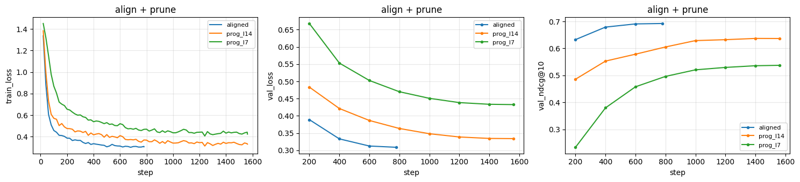
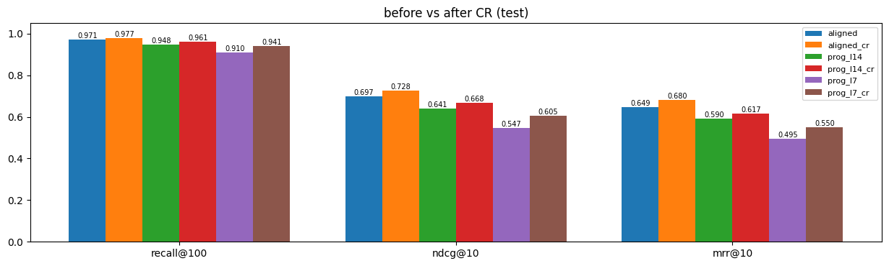
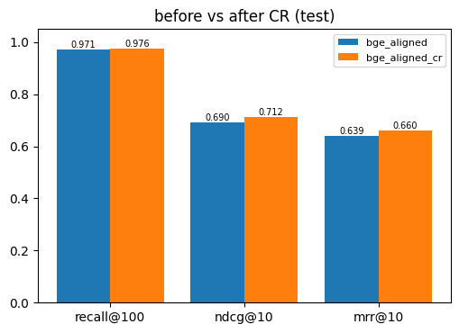
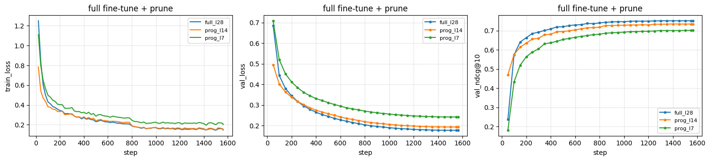
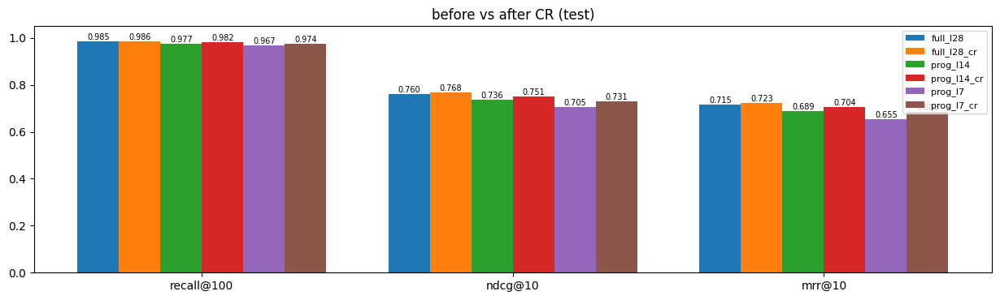

# Progressive Embedding Distillation

### A Three-Phase Training Recipe for Building Efficient Retrieval Models

## 1. Problem Statement

Large embedding models provide strong retrieval performance but are expensive to deploy, particularly when query encoding needs to happen online with low latency.

The objective of this project is to investigate whether a smaller embedding model can approximate the representation space of a strong teacher model while retaining retrieval performance.

I explore a three-phase training recipe:

1. **L2 Alignment:** Align a smaller student model with the teacher's embedding representations.
2. **Structured Pruning and Recovery:** Progressively reduce student model depth and recover the pruned model using L2 alignment.
3. **Contrastive Refinement:** Improve retrieval-specific discrimination between relevant and irrelevant documents.

The overall goal is to reduce model size and inference latency while retaining compatibility with a fixed teacher document index.

## 2. Teacher Embedding Generation

I use a Qwen 4B embedding model as the teacher. The teacher is kept frozen, and its embeddings are precomputed for queries and documents.

I did not fine-tune the teacher itself. It already provided a strong retrieval baseline, and the available computational budget was insufficient to justify additional teacher training. The objective was to transfer its embedding representations to smaller models rather than improve the teacher.

All embeddings are generated with an output dimension of **256** and cached for subsequent experiments.

**Notebook:** [Teacher Embedding Generation](https://www.kaggle.com/code/tensorpanda231/01-generate-teacher-embeddings)

## 3. Dataset and Experimental Setup

I use the [Tevatron MS MARCO Passage dataset](https://huggingface.co/datasets/Tevatron/msmarco-passage/viewer/default/train?row=0).

The dataset contains queries along with their corresponding positive and negative passages. I selected a subset because it provides useful retrieval supervision while remaining manageable with the available computational resources.

The experimental data is divided as follows:

| Split            | Records                                  | Usage                                |
| ---------------- | ---------------------------------------- | ------------------------------------ |
| Validation       | 5K queries with passages                 | Validation                           |
| Test             | 5K queries with passages                 | Final evaluation                     |
| Train            | 90K queries with positives and negatives | Phases 1, 2 and 3                    |
| Additional train | 110K queries, without passages           | Phases 1 and 2 (L2 alignment only)   |

The retrieval corpus consists of **299,985 passages**: the positives and one stored negative of each of the 100K core (train, validation and test) queries, about 200K passages, plus 100K random distractor passages.

An important detail is that distractor documents are part of the fixed teacher document index. The student does not receive these documents as alignment or training targets. They serve exclusively as competing candidates during retrieval.

### Computational Setup

All experiments were conducted using two NVIDIA T4 GPUs on Kaggle.

| Configuration                    | Value                                        |
| -------------------------------- | -------------------------------------------- |
| Hardware                         | 2 × NVIDIA T4                                |
| Teacher output dimension         | 256                                          |
| Teacher query maximum length     | 64 (including the ~20-token instruction prompt) |
| Student query maximum length     | 32                                           |
| Document maximum sequence length | 128                                          |
| Retrieval corpus                 | 299,985 passages                             |

## 4. Teacher Baseline

Before training the student models, I evaluated the teacher against the retrieval corpus on the internal test split (5K queries).

| Metric      | Teacher |
| ----------- | ------- |
| Recall\@100 | 0.9928  |
| Recall\@10  | 0.9457  |
| nDCG\@10    | 0.8063  |
| MRR\@10     | 0.7639  |

These metrics capture different aspects of retrieval quality:

- **Recall\@K:** Measures the fraction of relevant documents retrieved within the top K results.

  `Recall@K = |Relevant ∩ TopK| / |Relevant|`
- **nDCG\@10:** Measures ranking quality by accounting for both relevance and position. It normalizes discounted cumulative gain against the ideal ranking.

  `DCG@10 = Σ [(2^rel_i - 1) / log2(i + 1)]`

  `nDCG@10 = DCG@10 / IDCG@10`
- **MRR\@10:** Measures the reciprocal rank of the first relevant document, averaged across queries.

  `MRR@10 = (1 / |Q|) Σ [1 / rank_q]`

  Queries without a relevant result in the top 10 receive a score of zero.

Recall measures retrieval coverage, nDCG measures the quality of the overall ranking, and MRR emphasizes how quickly the first relevant result appears.

These metrics together provide a more complete picture than using recall alone.

## 5. Three-Phase Training Recipe

### Phase 1: L2 Alignment

I use Qwen 0.6B as the initial student model.

The objective is to train the student to reproduce the teacher's embeddings for the same queries. Only queries are aligned: the student is a query encoder, and documents are embedded once by the teacher and never encoded by the student. Teacher embeddings are already cached, so the teacher does not need to participate in the student training loop.

This phase attempts to transfer the teacher's embedding space to a smaller model.

### Phase 2: Structured Pruning and Recovery

After obtaining an aligned student, I investigate reducing its depth through structured layer pruning.

My initial pruning strategy removes evenly spaced Transformer layers. The remaining layers are then trained again using the L2 alignment objective to recover the lost representation quality.

I also conducted additional experiments with importance-based pruning to investigate whether selecting layers based on their importance produces better results than uniform depth reduction.

**Notebook:** [Student Alignment and Pruning](https://www.kaggle.com/code/tensorpanda231/full-finetune-02-student-alignment-and-pruning)

### Phase 3: Contrastive Refinement

L2 alignment encourages the student to reproduce teacher embeddings, but vector approximation and retrieval discrimination are not necessarily the same objective.

I therefore introduce contrastive refinement using the available positive and negative passages.

The student is trained to produce query representations that rank relevant passages above negative passages, using the fixed teacher document index.

The motivation is to complement representation-level alignment with task-specific retrieval supervision.

**Notebook:** [Contrastive Refinement](https://www.kaggle.com/code/tensorpanda231/v3-03-contrastive-refinement), Version 3

## 6. Experiments

The experiments are listed in the order they were run. Every result uses the same 299,985-passage teacher index and the same internal 5K validation and 5K test queries.

- **Retention** = student nDCG\@10 / teacher nDCG\@10 on the same split (teacher: 0.8015 on validation, 0.8063 on test).
- **Latency** = query encoding only, in ms per query at batch size 1 and 32 (median of 3 repeats after a warm-up), on a Kaggle T4.
- `_cr` = after contrastive refinement. `prog_l14` / `prog_l7` = the student pruned to 14 / 7 Transformer layers and recovered with L2 alignment.

### 6.1 LoRA alignment and progressive pruning

**Notebook:** [02-student-alignment-and-pruning](https://www.kaggle.com/code/tensorpanda231/02-student-alignment-and-pruning), Version 1

The 28-layer Qwen3-Embedding-0.6B student is aligned with LoRA (r=16) and a linear head. The aligned student is then pruned to 14 layers and to 7 layers. Each pruned student is recovered with a full fine-tune using the L2 objective.

| Run (val) | Recall\@100 | Recall\@10 | nDCG\@10 | MRR\@10 | Retention |
| --------- | ----------- | ---------- | -------- | ------- | --------- |
| Teacher   | 0.9937      | 0.9405     | 0.8015   | 0.7591  | 1.0000    |
| aligned   | 0.9701      | 0.8635     | 0.6926   | 0.6419  | 0.8641    |
| prog_l14  | 0.9501      | 0.8105     | 0.6370   | 0.5862  | 0.7948    |
| prog_l7   | 0.9079      | 0.7153     | 0.5371   | 0.4845  | 0.6702    |

| Run (test) | Recall\@100 | Recall\@10 | nDCG\@10 | MRR\@10 | Retention |
| ---------- | ----------- | ---------- | -------- | ------- | --------- |
| Teacher    | 0.9928      | 0.9457     | 0.8063   | 0.7639  | 1.0000    |
| aligned    | 0.9707      | 0.8636     | 0.6975   | 0.6486  | 0.8651    |
| prog_l14   | 0.9479      | 0.8136     | 0.6410   | 0.5900  | 0.7951    |
| prog_l7    | 0.9098      | 0.7253     | 0.5470   | 0.4947  | 0.6784    |

| Model    | Parameters | bs=1 (ms/query) | bs=1 (q/s) | bs=32 (ms/query) | bs=32 (q/s) |
| -------- | ---------- | --------------- | ---------- | ---------------- | ----------- |
| aligned  | 606M       | 72.209          | 13.8       | 2.237            | 447.0       |
| prog_l14 | 376M       | 24.877          | 40.2       | 0.773            | 1294.4      |
| prog_l7  | 266M       | 13.050          | 76.6       | 0.442            | 2264.4      |

The aligned student keeps 86.5% of the teacher's test nDCG\@10. Pruning to 14 layers drops this to 79.5%, and pruning to 7 layers drops it to 67.8%. The aligned model's 606M parameters include the LoRA adapter on top of the 596M base.

### 6.2 Contrastive refinement of the LoRA-aligned students

**Notebook:** [03-contrastive-refinement](https://www.kaggle.com/code/tensorpanda231/03-contrastive-refinement), Version 4

Contrastive refinement is applied to each student from 6.1. Only the 28-layer student was LoRA-tuned. The pruned students were fully fine-tuned during recovery.

| Run (test)  | Recall\@100 | Recall\@10 | nDCG\@10 | MRR\@10 | Retention |
| ----------- | ----------- | ---------- | -------- | ------- | --------- |
| Teacher     | 0.9928      | 0.9457     | 0.8063   | 0.7639  | 1.0000    |
| aligned     | 0.9707      | 0.8636     | 0.6975   | 0.6486  | 0.8651    |
| aligned_cr  | 0.9772      | 0.8878     | 0.7276   | 0.6802  | 0.9025    |
| prog_l14    | 0.9479      | 0.8136     | 0.6410   | 0.5900  | 0.7951    |
| prog_l14_cr | 0.9611      | 0.8399     | 0.6681   | 0.6174  | 0.8287    |
| prog_l7     | 0.9098      | 0.7253     | 0.5470   | 0.4947  | 0.6784    |
| prog_l7_cr  | 0.9410      | 0.7888     | 0.6046   | 0.5500  | 0.7499    |

Contrastive refinement improves test nDCG\@10 by +0.0301 (aligned), +0.0271 (prog_l14) and +0.0576 (prog_l7). The smallest student gains the most.

### 6.3 A smaller architecture: BGE-small

**Notebook:** [05-bge-small-align-and-refine](https://www.kaggle.com/code/tensorpanda231/05-bge-small-align-and-refine), Version 5

The same recipe, L2 alignment followed by contrastive refinement, applied to `BAAI/bge-small-en-v1.5` as the student.

| Run (test)     | Recall\@100 | Recall\@10 | nDCG\@10 | MRR\@10 | Retention |
| -------------- | ----------- | ---------- | -------- | ------- | --------- |
| Teacher        | 0.9928      | 0.9457     | 0.8063   | 0.7639  | 1.0000    |
| bge_aligned    | 0.9709      | 0.8629     | 0.6905   | 0.6389  | 0.8564    |
| bge_aligned_cr | 0.9760      | 0.8850     | 0.7121   | 0.6601  | 0.8832    |

Contrastive refinement improves test nDCG\@10 by +0.0216 (from 85.6% to 88.3% retention).

### 6.4 Full fine-tune alignment and progressive pruning

**Notebook:** [full-finetune-02-student-alignment-and-pruning](https://www.kaggle.com/code/tensorpanda231/full-finetune-02-student-alignment-and-pruning), Version 7

Same as 6.1, except every weight of the 28-layer student is trained during alignment instead of a LoRA adapter.

| Run (val) | Recall\@100 | Recall\@10 | nDCG\@10 | MRR\@10 | Retention |
| --------- | ----------- | ---------- | -------- | ------- | --------- |
| Teacher   | 0.9937      | 0.9405     | 0.8015   | 0.7591  | 1.0000    |
| full_l28  | 0.9842      | 0.9064     | 0.7508   | 0.7040  | 0.9368    |
| prog_l14  | 0.9765      | 0.8931     | 0.7342   | 0.6864  | 0.9161    |
| prog_l7   | 0.9693      | 0.8664     | 0.7008   | 0.6513  | 0.8743    |

| Run (test) | Recall\@100 | Recall\@10 | nDCG\@10 | MRR\@10 | Retention |
| ---------- | ----------- | ---------- | -------- | ------- | --------- |
| Teacher    | 0.9928      | 0.9457     | 0.8063   | 0.7639  | 1.0000    |
| full_l28   | 0.9847      | 0.9108     | 0.7600   | 0.7150  | 0.9426    |
| prog_l14   | 0.9767      | 0.8928     | 0.7357   | 0.6886  | 0.9125    |
| prog_l7    | 0.9672      | 0.8694     | 0.7046   | 0.6553  | 0.8739    |

| Model    | Parameters | bs=1 (ms/query) | bs=1 (q/s) | bs=32 (ms/query) | bs=32 (q/s) |
| -------- | ---------- | --------------- | ---------- | ---------------- | ----------- |
| full_l28 | 596M       | 48.515          | 20.6       | 1.468            | 681.0       |
| prog_l14 | 376M       | 25.190          | 39.7       | 0.799            | 1251.2      |
| prog_l7  | 266M       | 13.298          | 75.2       | 0.451            | 2216.5      |

The full fine-tune raises test nDCG\@10 over the LoRA run at every depth: +0.0625 at 28 layers (0.6975 → 0.7600), +0.0947 at 14 layers and +0.1576 at 7 layers. The 7-layer student has 55% fewer parameters than the 28-layer one, is 3.6× faster at batch size 1 (13.3 vs 48.5 ms/query), and keeps 87.4% of the teacher's test nDCG\@10.

### 6.5 Strong students in the 100–150M range

**Notebook:** [06-strong-students-full-finetune](https://www.kaggle.com/code/tensorpanda231/06-strong-students-full-finetune), Version 2

Three independent embedding models, fully fine-tuned with L2 alignment: DenseOn (`lightonai/DenseOn`), Granite R2 (`ibm-granite/granite-embedding-english-r2`) and E5-base (`intfloat/e5-base-v2`).

| Run (val)          | Recall\@100 | Recall\@10 | nDCG\@10 | MRR\@10 | Retention |
| ------------------ | ----------- | ---------- | -------- | ------- | --------- |
| Teacher            | 0.9937      | 0.9405     | 0.8015   | 0.7591  | 1.0000    |
| denseon_aligned    | 0.9758      | 0.8913     | 0.7253   | 0.6754  | 0.9049    |
| granite_r2_aligned | 0.9747      | 0.8897     | 0.7253   | 0.6761  | 0.9049    |
| e5_base_aligned    | 0.9750      | 0.8833     | 0.7152   | 0.6652  | 0.8924    |

| Run (test)         | Recall\@100 | Recall\@10 | nDCG\@10 | MRR\@10 | Retention |
| ------------------ | ----------- | ---------- | -------- | ------- | --------- |
| Teacher            | 0.9928      | 0.9457     | 0.8063   | 0.7639  | 1.0000    |
| denseon_aligned    | 0.9779      | 0.8910     | 0.7264   | 0.6771  | 0.9010    |
| granite_r2_aligned | 0.9778      | 0.8952     | 0.7327   | 0.6842  | 0.9088    |
| e5_base_aligned    | 0.9771      | 0.8869     | 0.7208   | 0.6713  | 0.8940    |

| Model      | Parameters | bs=1 (ms/query) | bs=1 (q/s) | bs=32 (ms/query) | bs=32 (q/s) |
| ---------- | ---------- | --------------- | ---------- | ---------------- | ----------- |
| denseon    | 149M       | 18.305          | 54.6       | 0.723            | 1382.8      |
| granite_r2 | 149M       | 18.236          | 54.8       | 0.710            | 1407.7      |
| e5_base    | 109M       | 8.069           | 123.9      | 0.375            | 2663.3      |

With L2 alignment alone, Granite R2 (149M) reaches 0.7327 test nDCG\@10, above the pruned 7-layer Qwen student (266M, 0.7046). E5-base (109M) is the fastest model measured, at 8.1 ms/query at batch size 1, and keeps 89.4% of the teacher's test nDCG\@10.

### 6.6 Contrastive refinement: number of negatives

**Notebook:** [v3-03-contrastive-refinement](https://www.kaggle.com/code/tensorpanda231/v3-03-contrastive-refinement), Version 1 (1 negative), Version 2 (4 negatives), Version 3 (8 negatives)

Contrastive refinement of the fully fine-tuned students from 6.4, with 1, 4 and 8 negatives per query.

| Student  | Before CR | CR, 1 negative (v1) | CR, 4 negatives (v2) | CR, 8 negatives (v3) |
| -------- | --------- | ------------------- | -------------------- | -------------------- |
| full_l28 | 0.7600    | 0.7626 (+0.0026)    | 0.7668 (+0.0068)     | 0.7675 (+0.0075)     |
| prog_l14 | 0.7357    | 0.7442 (+0.0085)    | 0.7503 (+0.0146)     | 0.7513 (+0.0156)     |
| prog_l7  | 0.7046    | 0.7212 (+0.0166)    | 0.7303 (+0.0257)     | 0.7315 (+0.0269)     |

*Test nDCG\@10. The full tables are below.*

Full test tables for Versions 1, 2 and 3

**Version 1: 1 negative**

| Run (test)  | Recall\@100 | Recall\@10 | nDCG\@10 | MRR\@10 | Retention |
| ----------- | ----------- | ---------- | -------- | ------- | --------- |
| Teacher     | 0.9928      | 0.9457     | 0.8063   | 0.7639  | 1.0000    |
| full_l28    | 0.9847      | 0.9108     | 0.7600   | 0.7150  | 0.9426    |
| full_l28_cr | 0.9842      | 0.9125     | 0.7626   | 0.7178  | 0.9458    |
| prog_l14    | 0.9767      | 0.8928     | 0.7357   | 0.6886  | 0.9125    |
| prog_l14_cr | 0.9808      | 0.9006     | 0.7442   | 0.6975  | 0.9230    |
| prog_l7     | 0.9672      | 0.8694     | 0.7046   | 0.6553  | 0.8739    |
| prog_l7_cr  | 0.9739      | 0.8835     | 0.7212   | 0.6729  | 0.8945    |

**Version 2: 4 negatives**

| Run (test)  | Recall\@100 | Recall\@10 | nDCG\@10 | MRR\@10 | Retention |
| ----------- | ----------- | ---------- | -------- | ------- | --------- |
| Teacher     | 0.9928      | 0.9457     | 0.8063   | 0.7639  | 1.0000    |
| full_l28    | 0.9847      | 0.9108     | 0.7600   | 0.7150  | 0.9426    |
| full_l28_cr | 0.9854      | 0.9171     | 0.7668   | 0.7219  | 0.9510    |
| prog_l14    | 0.9767      | 0.8928     | 0.7357   | 0.6886  | 0.9125    |
| prog_l14_cr | 0.9811      | 0.9023     | 0.7503   | 0.7044  | 0.9306    |
| prog_l7     | 0.9672      | 0.8694     | 0.7046   | 0.6553  | 0.8739    |
| prog_l7_cr  | 0.9733      | 0.8858     | 0.7303   | 0.6843  | 0.9058    |

**Version 3: 8 negatives**

| Run (test)  | Recall\@100 | Recall\@10 | nDCG\@10 | MRR\@10 | Retention |
| ----------- | ----------- | ---------- | -------- | ------- | --------- |
| Teacher     | 0.9928      | 0.9457     | 0.8063   | 0.7639  | 1.0000    |
| full_l28    | 0.9847      | 0.9108     | 0.7600   | 0.7150  | 0.9426    |
| full_l28_cr | 0.9857      | 0.9157     | 0.7675   | 0.7231  | 0.9519    |
| prog_l14    | 0.9767      | 0.8928     | 0.7357   | 0.6886  | 0.9125    |
| prog_l14_cr | 0.9818      | 0.9072     | 0.7513   | 0.7044  | 0.9318    |
| prog_l7     | 0.9672      | 0.8694     | 0.7046   | 0.6553  | 0.8739    |
| prog_l7_cr  | 0.9742      | 0.8877     | 0.7315   | 0.6853  | 0.9072    |

The gain from contrastive refinement grows as the student gets smaller, at every number of negatives. Going from 1 to 4 negatives adds +0.004 to +0.009 nDCG\@10. Going from 4 to 8 adds at most +0.0012. With 8 negatives, the 7-layer student reaches 0.7315 test nDCG\@10 (90.7% retention).

### 6.7 Summary

Test split. The best contrastive-refinement run is used for each fully fine-tuned student (8 negatives, 6.6 Version 3).

| Model                       | Parameters | bs=1 latency (ms/query) | Recall\@10 | nDCG\@10 | MRR\@10 | Retention |
| --------------------------- | ---------- | ----------------------- | ---------- | -------- | ------- | --------- |
| Teacher (Qwen3-Embedding-4B) | 4B        | —                       | 0.9457     | 0.8063   | 0.7639  | 1.0000    |
| LoRA aligned (6.1)          | 606M       | 72.209                  | 0.8636     | 0.6975   | 0.6486  | 0.8651    |
| LoRA aligned_cr (6.2)       | 606M       | 72.209                  | 0.8878     | 0.7276   | 0.6802  | 0.9025    |
| full_l28 (6.4)              | 596M       | 48.515                  | 0.9108     | 0.7600   | 0.7150  | 0.9426    |
| full_l28_cr (6.6)           | 596M       | 48.515                  | 0.9157     | 0.7675   | 0.7231  | 0.9519    |
| prog_l14 (6.4)              | 376M       | 25.190                  | 0.8928     | 0.7357   | 0.6886  | 0.9125    |
| prog_l14_cr (6.6)           | 376M       | 25.190                  | 0.9072     | 0.7513   | 0.7044  | 0.9318    |
| prog_l7 (6.4)               | 266M       | 13.298                  | 0.8694     | 0.7046   | 0.6553  | 0.8739    |
| prog_l7_cr (6.6)            | 266M       | 13.298                  | 0.8877     | 0.7315   | 0.6853  | 0.9072    |
| DenseOn aligned (6.5)       | 149M       | 18.305                  | 0.8910     | 0.7264   | 0.6771  | 0.9010    |
| Granite R2 aligned (6.5)    | 149M       | 18.236                  | 0.8952     | 0.7327   | 0.6842  | 0.9088    |
| E5-base aligned (6.5)       | 109M       | 8.069                   | 0.8869     | 0.7208   | 0.6713  | 0.8940    |
| BGE-small aligned (6.3)     | —          | —                       | 0.8629     | 0.6905   | 0.6389  | 0.8564    |
| BGE-small aligned_cr (6.3)  | —          | —                       | 0.8850     | 0.7121   | 0.6601  | 0.8832    |

Contrastive refinement changes only the weights, so a `_cr` model has the same parameter count and latency as its base model.

## 7. Student Architecture Experiments

An important part of this investigation was understanding whether the proposed approach depends on a particular student architecture.

I conducted two additional sets of experiments:

**Different embedding architectures:** I evaluated several independent embedding models in the 100–150M parameter range. The objective was to determine whether the alignment and refinement recipe generalizes beyond the Qwen architecture.

[Notebook: Strong Student Models](https://www.kaggle.com/code/tensorpanda231/06-strong-students-full-finetune), Version 2. Results are in [6.5](#65-strong-students-in-the-100150m-range); the BGE-small run is in [6.3](#63-a-smaller-architecture-bge-small).

**Different model capacities:** I also experimented with student models from the same model family, with progressively increasing parameter counts.

These experiments help investigate the capacity limitations of L2 alignment. Smaller models may have limited ability to approximate the teacher's embedding representations, whereas larger students can potentially reproduce them more accurately.

Contrastive refinement provides an additional retrieval-specific learning signal, helping the student distinguish positive and negative documents rather than focusing exclusively on matching teacher vectors.

## 8. Retrieval and Latency Evaluation

The final evaluation compares the teacher, aligned students, pruned students, and contrastively refined models.

Along with retrieval metrics, I investigate inference latency to understand the practical benefits of model compression.

[Notebook: Retrieval Evaluation and Ablations](https://www.kaggle.com/code/tensorpanda231/04-retrieval-evaluation-and-ablation)

The main evaluation criteria are:

- Retrieval effectiveness: Recall\@10, Recall\@100, nDCG\@10 and MRR\@10.
- Model efficiency: Parameter count and inference latency.
- Compression effectiveness: Retrieval performance retained after pruning and recovery.

## 9. Future Directions

There are several directions worth exploring further:

1. **Quantization:** Evaluate INT8 and other quantization strategies to reduce memory consumption and improve online inference latency.
2. **Pruning strategies:** Investigate better importance-based and retrieval-aware structured pruning techniques.
3. **Contrastive learning:** Explore alternative contrastive objectives, hard-negative strategies and training configurations.
4. **Embedding alignment:** Investigate the limits of L2-based alignment across different model capacities and architectures.

An interesting related work is [LEAF: Knowledge Distillation of Text Embedding Models with Teacher-Aligned Representations (ACL 2026)](https://aclanthology.org/2026.acl-long.2008.pdf).

LEAF demonstrates that directly aligning student representations with teacher embeddings using an L2 objective can be an effective knowledge distillation strategy. Its experiments also report that adding more elaborate internal representation losses did not improve its downstream retrieval results.

This provides further motivation to investigate embedding alignment as a standalone foundation and study how pruning, recovery and contrastive refinement can complement it.

## 10. Conclusion

This project investigates a progressive approach to building efficient retrieval models by combining teacher embedding alignment, structured model pruning, recovery and contrastive refinement.

Rather than treating compression as an isolated operation, the objective is to study how representation learning and task-specific optimization can work together to produce smaller retrieval models with competitive effectiveness and better inference efficiency.

Further experimental results and ablation studies will help establish the effectiveness and limitations of this approach.
